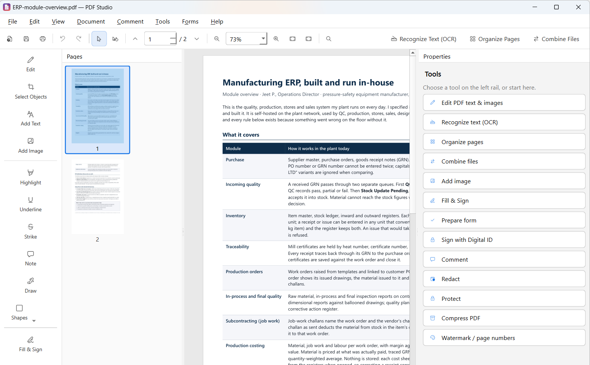

# PDF Studio

A free, open-source desktop PDF editor for Windows (Python + PyQt6 + PyMuPDF + Tesseract), with the everyday features of a commercial PDF editor: edit text in its original font, edit scanned pages, forms, digital signatures, OCR, and export to Word, Excel and CAD.



**Download:** get the Windows installer (`PDFStudio-Setup-x.y.z.exe`) from the [Releases](../../releases) page. Windows 10 or 11, 64-bit.

**Licence:** GNU AGPL v3. See [LICENSE](LICENSE) and [Third-party components](#third-party-components).

## Run

```
pip install -r requirements.txt
python main.py [file.pdf]
```

For OCR, install [Tesseract 5](https://github.com/UB-Mannheim/tesseract/wiki). Add language packs if you need them.

## Features

| Area | What it does |
|---|---|
| **Edit text** | Click any paragraph (Edit tool). The editor finds the original font, size, colour, bold/italic, alignment and line spacing. When you apply the edit, the old glyphs are removed and the new text is written with the embedded font. If that font is a subset missing some characters, it uses the closest installed font instead. |
| **Scanned PDFs** | Choosing **Edit** on a scanned document offers to recognise the text. After that, click any text on the scan to edit it. Only the words you change are replaced: they are erased from the scan (table lines are kept) and retyped in the detected font, weight, size and colour. Everything else stays original scan pixels. Rotated, upside-down and skewed pages are handled, and the new text is searchable. |
| **OCR** | *Editable text* mode finds the typeface by drawing candidate fonts and comparing glyph shapes. It works out the point size from word widths and the text colour with k-means. It then paints over the scanned glyphs and writes real text at the exact word positions. *Searchable* mode adds an invisible text layer. |
| **Images** | Insert, move, resize (with aspect lock), arrange in front of or behind text, rotate, flip, crop, change opacity, brightness, contrast and saturation, or convert to grayscale. Background removal can take out white, take out a chosen colour (edge fill), or cut out the subject automatically with GrabCut. |
| **Organize** | Drag to reorder pages. You can also rotate, delete, duplicate, insert blank pages or pages from a file, extract pages, and split the document. |
| **Combine** | Merge PDFs and images, with a page range and a bookmark for each file. |
| **Comment** | Highlight, underline, strikethrough, sticky notes, freehand ink, rectangles, ellipses, lines and arrows. |
| **Other** | Fill & Sign (draw, type or use an image), redaction, AES-256 password protection, compression, watermarks and page numbers, find, print, and export to images or text. Undo and redo work for every change. |

## Moving & resizing things on the page

- **Text boxes** (Edit tool):
  - Click to edit, or drag to move.
  - Corner handles change width and height; left/right handles change width only (the text re-wraps); top/bottom handles change height only (line spacing adapts).
  - Every table cell, bubble number and view letter gets its own box, using the drawing's border lines to tell them apart.
- **Images** (Edit tool): drag to move, handles to resize (Shift toggles the aspect lock), Delete to remove.
- **Shapes and pen drawings** (Select, Hand or Edit tool):
  - Covers rectangles, ellipses, lines, arrows, polygons, pen strokes, notes and stamps.
  - Click to select, drag to move, handles to resize (Shift keeps proportions), Delete to remove.
  - Colour, line width, fill, opacity and arrowheads are kept.
  - After drawing a shape, the app switches back to Select with the new shape selected.
- **Figures in drawings** (Objects tool, key `O`), e.g. a CAD view, a detail, a symbol:
  - The app works out where each figure begins and ends by itself: it joins lines that touch or run close together, and pulls in the arcs, hatching, bubble numbers and leader lines that belong to the figure. Hovering outlines the figure under the pointer, so you see what a click will take.
  - Click to select that whole figure — never half a line. Ctrl+click adds another figure or removes one; Ctrl+A takes every figure on the page.
  - Dragging a box selects each figure that lies mostly inside it, complete; a box drawn inside one big figure selects that figure. Hold Alt while dragging to take exactly the lines inside the box instead.
  - Drag to move (Shift keeps it on one axis); corner handles resize proportionally (Shift for free resizing); arrow keys nudge (Shift = 10 pt).
  - `[` and `]` rotate left and right; `M` mirrors, `Shift+M` mirrors top to bottom. Labels turn with the figure but stay upright and readable.
  - Ctrl+C / Ctrl+V copy and paste at the mouse position (on any page), Ctrl+X cut, Ctrl+D duplicate, Delete remove, Esc deselect. Every step can be undone.
  - Right-click for the same commands plus **Save as image…** (300 dpi PNG). Copies also go to the Windows clipboard as a picture.
  - The rest of the drawing stays pixel-identical.

## Forms & signatures

- **Fill forms** directly on the page: text boxes, check boxes, radio groups, dropdowns, lists. Every change can be undone.
- **Prepare Form** (Forms button on the left rail):
  - Pick a field type, then click or drag on the page.
  - Move and resize fields, and set their properties (name, tooltip, required, read-only, multi-line, font size, options).
  - **Auto-detect fields** creates fields for fill-in lines, underscores, check boxes and labelled boxes.
- **Form data:** clear, flatten (burns values into the page), and export/import field values as JSON.
- **Handwritten signature:** click a signature field and draw, type or pick an image.
- **Digital ID signatures** (Forms ▸ Sign with Digital ID):
  - Certificate-based PAdES signatures via pyHanko, using a `.pfx` Digital ID. You can create one in the app.
  - The signed file is saved as a new copy.
  - When a signed PDF is opened, the status bar shows whether its signatures are valid and trusted, and whether the document changed after signing. Forms ▸ Verify Signatures gives the full details.

## Export / convert

- **PDF → Word (.docx):** keeps reading order, paragraphs, fonts (family, size, bold, italic, colour), rough alignment, images, tables and page size/orientation.
- **PDF → Excel (.xlsx):** each detected table goes on a sheet. Amounts such as `1,59,500.00`, `(1,200)` or `12.5%` become real numbers.
  - For scanned documents, ruled tables are found in the page image and filled from the OCR text; multi-line item descriptions stay in one cell.
- **PDF → text** and **PDF → images** (PNG per page).

## Engineering drawings → CAD (DXF)

File ▸ Export ▸ **Export drawing to CAD (.dxf)…** turns the drawing on the current page back into CAD geometry that opens in AutoCAD, BricsCAD, LibreCAD or FreeCAD.

- A PDF holds no circles or arcs — a circle arrives as hundreds of tiny straight pieces. PDF Studio chains those pieces back together and fits them, so the DXF contains real **ARC**, **CIRCLE** and **LWPOLYLINE** entities instead of line confetti.
- Line style decides the layer: thick solid → `VISIBLE`, thin → `THIN`, dashed → `HIDDEN`, long-dash-dot → `CENTRE`, grey → `DIMENSIONS`, filled → `HATCH`, and all text on `TEXT`.
- Text labels are kept as MTEXT at their own size, position and angle.
- **Scale**: the app reads the drawing's own dimension texts (a "321 mm" sitting on a line 321 mm long) and uses that millimetre-per-point scale when several dimensions agree. When they don't — numbers in a parts table, for instance — it writes the sheet at paper size and you can set the scale yourself in the dialog.
- **Scanned drawings** have no vectors at all, so the page image is traced first (threshold, stroke detection, duplicate merging) and converted the same way.
- Optionally each detected view becomes its own **block**.

## Create PDF, split and repair

- **Word, Excel and PowerPoint → PDF**: just open the file (File ▸ Open, File ▸ Create PDF, or drag it onto the window).
  - With Microsoft Office installed, Office itself makes the PDF, so fonts, tables, headers, footers and page breaks look exactly as they do in Office. Macros are switched off during the conversion.
  - Without Office, Word files (.docx) are converted by PDF Studio: headings, text styles, lists, tables and pictures come through, but elaborate layouts may differ.
  - The result opens as a new, unsaved PDF; Save asks where to put it, so your original document is never overwritten.
- **PDF → Word / Excel / DXF**: File ▸ Export.
- **Images → PDF**: File ▸ Create PDF ▸ From Images, or drop several pictures on the window. Reorder them, then pick the page size (each image's own size, A4, A3, A5, Letter, Legal), orientation, margin and whether each image fits, fills or keeps its actual size. Every page of a multi-page TIFF is included, phone photos are turned upright, and JPEGs are embedded without re-compression.
- **Split PDF** (File ▸ Split PDF): every N pages, by page ranges (`1-3, 4-10, 11-`), at each top-level bookmark (chapter), or into files no larger than a size you choose. A preview lists every file before anything is written; each part keeps its own bookmarks.
- **Repair PDF** (File ▸ Repair PDF): two repair engines (MuPDF and qpdf) are tried and the better result is kept. The document is rebuilt page by page, so one broken page cannot sink the rest; a page whose data is cut off is kept as a picture of what survived. A report lists what was wrong and which pages to check. A PDF that fails to open offers repair automatically. Your original file is never changed.

## Security

No software can honestly be called unhackable, but PDF Studio is built to be hard to attack and hard to tamper with:

- **Harmful PDFs cannot act inside PDF Studio**: it never runs a PDF's JavaScript, never performs launch or automatic actions, and never opens attached files.
- **Warning on open**: if a PDF contains JavaScript, automatic or program-launch actions, links to local files, or attached programs (.exe, .js, .vbs, …), PDF Studio says so and offers to remove them, since other PDF readers might run them. Normal links, bookmarks, harmless attachments and form fields keep working. Also available as File ▸ Remove Scripts & Hidden Actions.
- **No DLL planting**: when a PDF is double-clicked, the app moves out of that PDF's folder at start-up, so a malicious DLL or program placed next to the PDF is never picked up. Helper programs (PowerShell, Tesseract) are started by full path.
- **Office conversions** run with macros force-disabled; file paths are passed as arguments, never pasted into script code.
- **Native build** (`build_installer_native.bat`): Nuitka compiles the Python code to C and then to machine code, so the installed program contains no Python source or bytecode to decompile; the build fails if any app source or bytecode is found in the package.

## Running on any Windows PC

- Windows 10 or 11, 64-bit. (Qt 6 and Python 3.14 both require Windows 10 1809 or newer, so Windows 7 and 8.1 are not supported.)
- The app ships the Microsoft C++ runtime files it needs, and uses the **headless** build of OpenCV — the normal one demands Windows Media Foundation, which is missing on Windows N/KN editions and on trimmed installs, where it fails with *"DLL load failed while importing cv2"*.
- **OpenCV is optional.** If it still cannot load on some PC, PDF Studio starts anyway: editing, page organising, forms, signing, export, images → PDF, split and repair all keep working, and only the image-based features (scanned-page editing, OCR, table export from scans, tracing scanned drawings) report what is missing and how to fix it.
- **File ▸ Diagnose Problems…** (or `PDFStudio.exe --diagnose`) writes `%APPDATA%\PDFStudio\diagnostic.txt`: Windows edition, which components loaded, which system libraries are missing, and where Tesseract is. Send that file when a PC misbehaves.
- The installer removes an older version's files before installing, so two different builds can never be mixed in one folder.

## Compare & batch

- **Compare Files** (Tools menu):
  - Finds words that changed, were inserted or deleted, including across pages and in OCR'd scans.
  - Finds changed images and graphics.
  - Opens a report: a summary page, then side-by-side pages with colour-coded highlights. Hover a highlight to see the change.
- **Batch Process** (Tools menu):
  - Apply to a list of files or a whole folder: OCR, rotate, flatten forms, watermark, page numbers, compress, password protect, and export to Word/Excel/text.
  - Runs in the background with progress and a Stop button, and never modifies the original files.

## Installer

Double-click **`build_installer.bat`**. It will:
1. Generate the icon (`assets/make_icon.py`).
2. Build the app with PyInstaller (`installer/pdfstudio.spec`).
3. Bundle Tesseract OCR with English, Hindi, Gujarati and orientation data.
4. Self-test the built executable (`PDFStudio.exe --selftest`).
5. Compile `build/output/PDFStudio-Setup-1.0.0.exe` with Inno Setup (installed automatically via winget if it's missing).

The installer:
- Installs per user without needing admin rights (all users is optional).
- Adds Start Menu and desktop shortcuts, plus optional "Open with" / default app for PDFs.
- Registers an uninstaller.

## Layout

```
pdfeditor/
  app.py         bootstrap
  mainwindow.py  menus, toolbars, thumbnails, properties panel, search
  viewer.py      page canvas, tools, inline text editor, image handles
  document.py    document model + undo/redo
  textops.py     paragraph extraction and text replacement/layout
  fonts.py       system font index, PDF font name matching, glyph fallback
  ocr.py         Tesseract hOCR, font/size/colour recognition, inpainting
  imagetools.py  background removal and image adjustments
  pageimages.py  move/resize/replace/delete images on pages
  dialogs.py     image settings, OCR, organize, combine, sign, protect, watermark
```

## Known limitations

- Each paragraph is edited with its main style. Mixed bold or italic runs inside one paragraph become a single style.
- Rotated (non-horizontal) text lines are shown but can't be edited.
- OCR font matching only recognises installed fonts, with a list of about 20 common families to choose from.
- Moving an image re-inserts it. Clipping paths and other effects applied to the original image are dropped.

## Licence

Copyright (C) 2026 Jeet Patel.

PDF Studio is free software: you can redistribute it and/or modify it under the terms of the GNU Affero General Public License as published by the Free Software Foundation, version 3. It is distributed in the hope that it will be useful, but WITHOUT ANY WARRANTY. See [LICENSE](LICENSE) for the full text.

## Third-party components

| Component | Licence |
|---|---|
| [PyMuPDF](https://github.com/pymupdf/PyMuPDF) / MuPDF | AGPL-3.0 |
| [PyQt6](https://www.riverbankcomputing.com/software/pyqt/) / Qt | GPL-3.0 |
| [OpenCV](https://opencv.org/) | Apache-2.0 |
| [Tesseract OCR](https://github.com/tesseract-ocr/tesseract) (bundled in the installer) | Apache-2.0 |
| [pyHanko](https://github.com/MatthiasValvekens/pyHanko) | MIT |
| [pikepdf](https://github.com/pikepdf/pikepdf) / qpdf | MPL-2.0 / Apache-2.0 |
| [python-docx](https://github.com/python-openxml/python-docx), [openpyxl](https://openpyxl.readthedocs.io/), [cryptography](https://cryptography.io/) | MIT / MIT / Apache-2.0 or BSD |
| [NumPy](https://numpy.org/), [Pillow](https://python-pillow.org/), [fontTools](https://github.com/fonttools/fonttools) | BSD / HPND / MIT |
